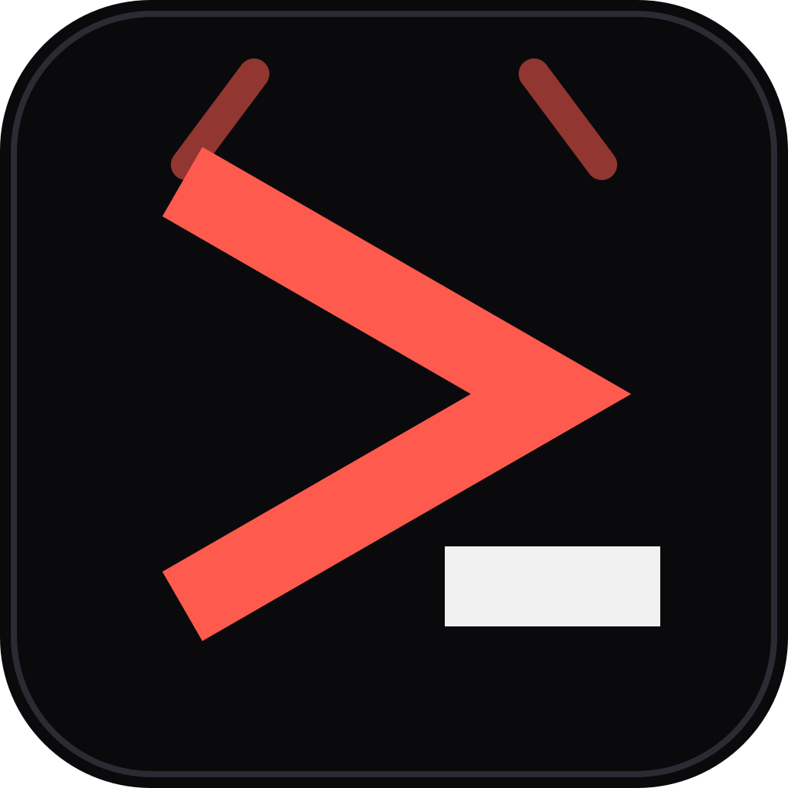
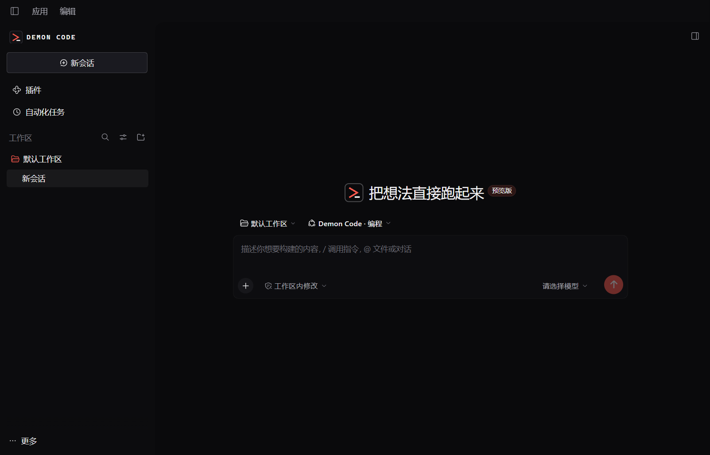
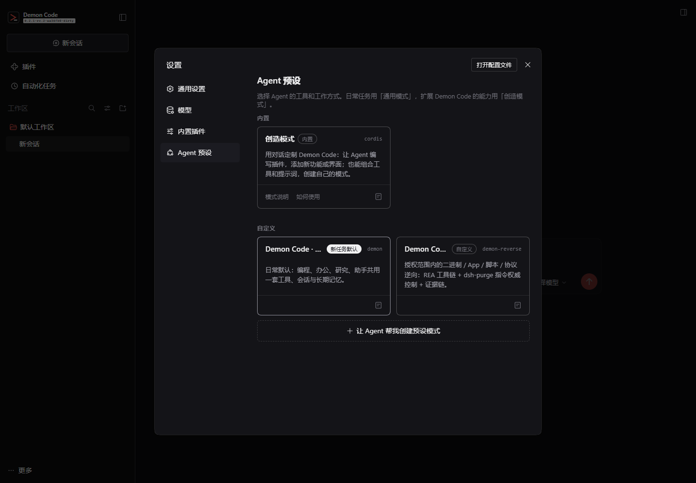
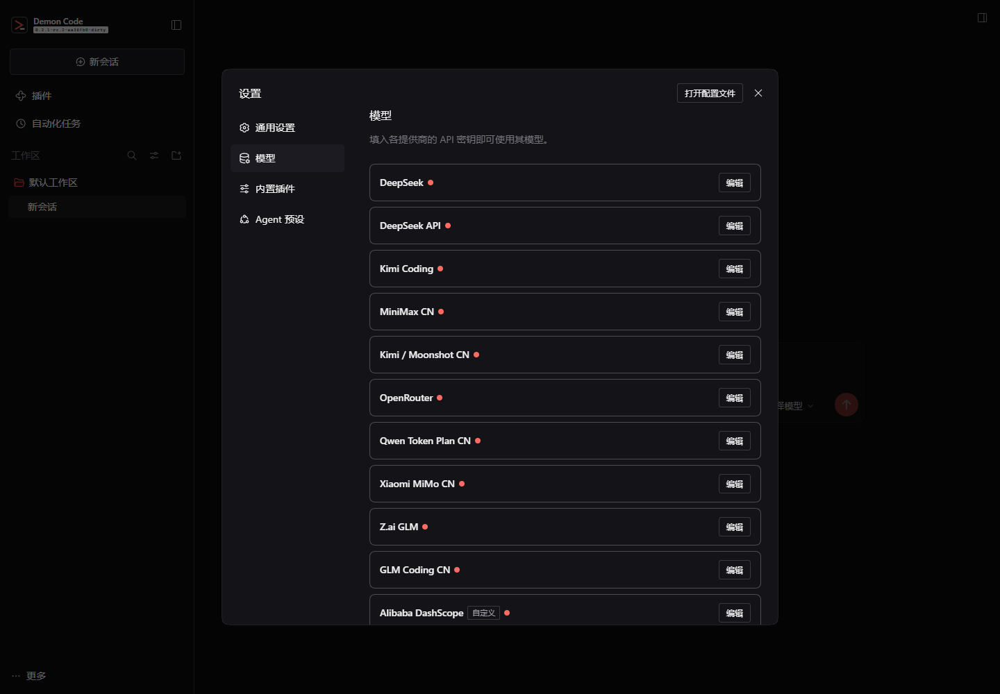

<p align="center">
  
</p>

<h1 align="center">DEMON CODE</h1>

<p align="center"><strong>把想法直接跑起来的桌面智能体。</strong><br/>
Codex 风味的界面 · 三种 Agent 预设 · 内置 Moli 无头浏览器 · 国产模型优先</p>

<p align="center">
  <a href="https://github.com/z416946520/Demon-Code"></a>
  
  
  
  
</p>

<p align="center">
  <a href="https://z416946520.github.io/Demon-Code/">官网</a> ·
  <a href="#快速开始">下载</a> ·
  <a href="#三个预设">预设</a> ·
  <a href="#内置-moli-浏览器">浏览器</a> ·
  <a href="#架构">架构</a> ·
  <a href="docs/VERIFICATION.md">验证记录</a>
</p>



Demon Code 是一个面向 Windows 的 AI 开发工作台：编程、办公、研究、日常助手共用同一个工作区、同一套工具、同一份会话与长期记忆。它构建在 [DeepSeek Harness](https://github.com/deepseek-ai/deepseek-harness)（MIT）的插件化内核上，桌面端重新做了 Codex 风味的暗色界面，并加入了国产模型路由、内置 Moli 浏览器、三种 Agent 预设和长期记忆。

> 独立定制发行版，与 DeepSeek、OpenAI、Moli 官方无隶属关系。上游许可证与声明见 [LICENSE](LICENSE)、[THIRD_PARTY_NOTICES.md](THIRD_PARTY_NOTICES.md)。

## 目录

- [为什么是 Demon Code](#为什么是-demon-code)
- [三个预设](#三个预设)
- [内置 Moli 浏览器](#内置-moli-浏览器)
- [模型](#模型)
- [快速开始](#快速开始)
- [第一次使用](#第一次使用)
- [插件与扩展](#插件与扩展)
- [长期记忆](#长期记忆)
- [架构](#架构)
- [功能覆盖](#功能覆盖)
- [安全与权限](#安全与权限)
- [验证](#验证)
- [从源码构建](#从源码构建)
- [目录结构](#目录结构)
- [已知边界](#已知边界)
- [对比市面工具](#对比市面工具)
- [许可与致谢](#许可与致谢)

## 为什么是 Demon Code

- **一个 Agent，三种预设**：通用、逆向、创造。日常不需要在十个模式里做选择。
- **编程闭环**：先读代码 → 计划 → 最小改动 → 跑最窄验证 → 交付证据。编程纪律写在默认预设里。
- **办公不是外挂**：Word / Excel / PowerPoint / PDF 的生成、重算、渲染检查是内置技能。
- **浏览器是内置能力**：Moli（约 2 万星的 Rust 无头浏览器）通过 `dsh-moli` 接入，`moli_fetch` / `moli_probe` 全局可用。
- **国产模型优先**：DeepSeek、Kimi、Qwen、GLM、MiniMax、豆包、混元、SiliconFlow、OpenRouter、Ollama 共 15 条预置路由。
- **插件双入口**：dsh/Cordis 插件原生加载；pi 的 skills / prompts / themes 可导入；MCP 客户端可用。
- **记忆可审计**：两层 Markdown 记忆，可检索、可提交 Git、可回滚，不是黑盒向量库。
- **不重写核心循环**：基于经过测试的 DeepSeek Harness Agent 循环做发行版，降低长任务失控的风险。

## 三个预设

| 预设 | 适合做什么 | 关键行为 |
|---|---|---|
| **Demon Code · 通用**（默认） | 日常全部任务：改代码、写文档、做表格、查资料、整理文件 | 先判断任务类型，再切到编程 / 办公 / 研究 / 助手协议；办公技能默认挂载；编程仍是最严格的读→改→验证闭环 |
| **Demon Code · 逆向** | 二进制 / App / 脚本 / 协议分析、patch 定位 | REA MCP（207 个工具）+ dsh-purge 指令权威控制 + demon-reverse 证据链技能 |
| **创造模式** | 写插件、组合工具与提示词、定制自己的预设 | 上游 Creator 预设，保留运行时检视与 Cordis 插件开发能力 |

默认是 **通用**。在 **设置 → 通用 → Agent 预设** 里切换；新会话生效。旧的 `demon-code` / `demon-assistant` / `demon-office` / `demon-research` / `standard` / `ptc` / `minimal` 会被自动迁移到 `demon`。



## 内置 Moli 浏览器

[Moli](https://github.com/lexmount/moli) 是为 AI Agent 设计的 Rust 无头浏览器：完整的 JavaScript、DOM、CSS、网络与布局能力，按需渲染，适合 Agent 读取页面和截图。

Demon Code 内置 [`dsh-moli`](https://github.com/27painter/dsh-moli) 桥接插件，所有预设共享两个工具：

| 工具 | 用途 |
|---|---|
| `moli_fetch` | 渲染 URL，返回 Markdown / HTML / semantic tree / JSON；支持 `selector`、`eval`、滚动、等待、截图、PDF |
| `moli_probe` | 检查 Moli 是否安装、版本、HTTPS 是否可用；缺失时可执行安装 |

**什么时候用 Moli**：

- 页面内容由 JavaScript 渲染，普通抓取只拿到空壳。
- 需要登录态、cookie 或用户资料目录。
- 只想读列表里的某一类卡片：`selector=".video-card"` 比整页 Markdown 小几十倍。
- 需要截图或 PDF。
- 需要等某个选择器、网络空闲或懒加载滚动后再读。

**什么时候不用**：静态文章、文档、API、纯 HTML 页面优先 `web_fetch`，更轻更快。

```text
moli_fetch url=https://example.com dump=markdown
moli_fetch url=https://example.com selector=".video-card"
moli_fetch url=https://example.com eval="document.title"
moli_fetch url=https://example.com dump=screenshot writeTo=D:/tmp/page.png
moli_fetch url=https://example.com dump=pdf writeTo=D:/tmp/page.pdf
moli_probe
moli_probe action=install
```

Moli 引擎（约 100 MB）**不随安装包捆绑**，由插件在本机 PATH 或 `%LOCALAPPDATA%\Moli\bin\moli.exe` 自动发现；缺失时可让 `moli_probe` 安装，或运行 Moli 官方安装脚本。安装包只包含桥接插件。

安全边界：Moli 只用于用户有权访问的页面。不要用它绕过付费墙、他人的登录或站点访问控制；抓取结果中的 cookie、token、会话信息不要写入报告或记忆文件。

## 模型

DeepSeek 官方路由 + pi-ai 多供应商适配器。密钥按请求解析，不进入配置文件；Models 页面可以实时增删路由。

| 路由 | 环境变量 | 说明 |
|---|---|---|
| `deepseek-official` | `DEEPSEEK_API_KEY` | 默认路由，工具调用最稳 |
| `deepseek` | `DEEPSEEK_API_KEY` | 同一 Key 走 pi-ai 目录 |
| `moonshotai-cn` | `MOONSHOT_API_KEY` | Kimi 长上下文 |
| `kimi-coding` | `KIMI_API_KEY` | Kimi 编程套餐 |
| `zai-coding-cn` | `ZAI_CODING_CN_API_KEY` | GLM 编程套餐 |
| `zai` | `ZAI_API_KEY` | GLM 通用 API |
| `minimax-cn` | `MINIMAX_CN_API_KEY` | MiniMax |
| `qwen-token-plan-cn` | `QWEN_TOKEN_PLAN_CN_API_KEY` | Qwen 编程套餐 |
| `dashscope` | `DASHSCOPE_API_KEY` | 阿里云百炼 OpenAI 兼容接口 |
| `volcengine` | `ARK_API_KEY` | 火山方舟 / 豆包 |
| `zhipu` | `ZHIPU_API_KEY` | 智谱 GLM |
| `hunyuan` | `HUNYUAN_API_KEY` | 腾讯混元 |
| `siliconflow` | `SILICONFLOW_API_KEY` | 硅基流动托管开源模型 |
| `openrouter` | `OPENROUTER_API_KEY` | 一个 Key 接多家 |
| `ollama` | 无需 Key | 本地 `127.0.0.1:11434` |

模型 ID 会随供应商更新。如果预置 ID 失效，在 **设置 → 模型** 里用端点发现重新拉取，或修改 `packages/bundle/base/cordis.patch.yml` 中对应路由的 `models`。



## 快速开始

> 官网下载页：https://z416946520.github.io/Demon-Code/#install

### 方式一：Windows 安装包

[从 GitHub Releases 下载安装包](https://github.com/z416946520/Demon-Code/releases/download/v0.2.1-rc.2.20261022.1/demon-code-0.2.1-rc.2.20261022.1-win-x64-unsigned.exe) · 274 MB

构建输出：`release/demon-code-0.2.1-rc.2.20261022.1-win-x64-unsigned.exe`

双击运行。安装包未签名，SmartScreen 提示“未知发布者”时选择“更多信息 → 仍要运行”。数据默认保存在 `%USERPROFILE%\.dsh`。

### 方式二：便携压缩包

[从 GitHub Releases 下载便携包](https://github.com/z416946520/Demon-Code/releases/download/v0.2.1-rc.2.20261022.1/Demon-Code-0.2.1-rc.2.20261022.1-win-x64-portable.zip) · 360 MB

构建输出：`release/Demon-Code-0.2.1-rc.2.20261022.1-win-x64-portable.zip`

解压到任意目录，双击 `Demon Code.exe` 运行，不需要安装。数据位置相同。

### 方式三：从源码运行

```sh
pnpm install
pnpm run build
pnpm run dev:desktop     # 桌面端开发模式
# 或
pnpm start:web           # 浏览器版，默认 127.0.0.1:3080
```

要求 Node.js `^22.19` 或 `>=24`，pnpm 11。

校验文件：[SHA256SUMS.txt](https://github.com/z416946520/Demon-Code/releases/download/v0.2.1-rc.2.20261022.1/SHA256SUMS.txt)；安装/卸载说明：[INSTALL.txt](https://github.com/z416946520/Demon-Code/releases/download/v0.2.1-rc.2.20261022.1/INSTALL.txt)。

## 自动更新

Demon Code 直接读取 GitHub Releases 判断版本，不依赖第三方更新服务。

- **检查**：启动后自动检查，之后每 10 分钟一次；也可以从应用菜单点 **检查更新**。
- **比较**：用语义版本比较 GitHub Release tag；内部 Build ID 显示在 **关于 Demon Code**，格式为 `版本+commit.构建时间`。
- **安装版**：下载对应 Windows 安装包 → 用 `SHA256SUMS.txt` 校验 SHA-256 → 退出应用 → 静默运行安装包 → 自动重启。
- **便携版**：下载便携 zip → 校验 → 退出应用 → 替换当前应用目录，保留带时间戳的 `.old-*` 备份后重启。
- **发布新版本**：创建 `vX.Y.Z` Release，上传安装包、便携包和 `SHA256SUMS.txt`。用户端的下一次检查会自动发现并更新。
- **内部构建版本**：产品版本保持 `0.2.1-rc.2`，每次构建使用 `0.2.1-rc.2.<YYYYMMDD>.<序号>`；Build ID 为 `版本+commit.构建时间`。构建命令：

  ```sh
  pnpm --filter @deepseek-ai/dsh-desktop run package:win:x64:unsigned --     --build-version 0.2.1-rc.2.$(date +%Y%m%d).1
  ```

安装包未签名，更新器只验证发布资产中的 SHA-256，不验证代码签名。只从 `https://github.com/z416946520/Demon-Code` 的 Release 读取更新。

## 第一次使用

1. 启动后可以直接填 DeepSeek API Key，或点“稍后配置”。
2. 进入 **设置 → 模型**，添加你持有的供应商 Key；密钥只进受管凭据文档。
3. 在 **设置 → 通用 → Agent 预设** 确认默认是“通用”；需要逆向时切到“逆向”。
4. 选一个工作区，直接描述任务。通用模式会自动判断是代码、文档、研究还是普通问题。
5. 需要浏览器时直接说“帮我打开/抓取这个页面”，模型会调用 `moli_fetch`；Moli 未安装时先 `moli_probe action=install`。

## 插件与扩展

### dsh / Cordis 插件（原生）

- 界面：**设置 → 插件**，可安装 npm / GitHub 来源的插件。
- 命令行：`dsh plugin --profile desktop add npm:<package>`。
- 插件运行在你的权限下，安装前先看源码。

### pi 资源（桥接）

```sh
pnpm demon:pi-bridge:dry    # 预览会导入什么
pnpm demon:pi-bridge        # 导入
```

- **skills**：复制到 `~/.dsh/skills/pi-*`，所有预设可用。
- **prompts**：转换成技能 `pi-prompt-*`。
- **themes**：复制到 `~/.dsh/themes/pi-imports/` 备查。
- **extensions**：不会在 Demon Code 进程内执行。pi 扩展依赖 pi 自己的 `ExtensionAPI`，需要执行时使用真实 `pi` CLI，或移植成 Cordis 插件。

pi 和 Demon Code 都扫描 `~/.agents/skills/`，放在那里的技能天然共享。

### MCP

内置 MCP 客户端；第三方 MCP 服务器可按 dsh 的标准配置接入。REA 逆向模式本身就是一个 MCP 服务器示例。

## 长期记忆

Demon Code 不训练模型权重，也不假装“越用越聪明”。它用可审计的文件记忆实现长期积累：

```text
~/.dsh/MEMORY.md               跨项目偏好、机器环境、常用路径
<workspace>/.demon/MEMORY.md   项目构建命令、架构约束、踩过的坑
```

每条记忆一行：`日期 | 分类 | 事实 | 来源`。内置 `demon-memory` 技能规定何时读、何时写、如何删，并禁止写入密钥。项目记忆可以跟着仓库一起提交、审查、回滚。

会话日志本身是完整轨迹；SQLite 搜索索引按需建立，用于回查历史。

## 架构

```text
┌──────────────────────────────────────────────────────────────┐
│ Electron 桌面壳                                               │
│ 窗口 / 托盘 / 单实例 / 欢迎页 / 更新 / 崩溃恢复 / 资产注入      │
└───────────────────────────┬──────────────────────────────────┘
                            │ local HTTP + token
┌───────────────────────────▼──────────────────────────────────┐
│ Host 进程（dsh profile: desktop）                             │
│ profile = 有序 bundle patch + 用户 patch                      │
└───────────────────────────┬──────────────────────────────────┘
                            │ Cordis 插件树
┌───────────────────────────▼──────────────────────────────────┐
│ Agent 预设                                                     │
│  通用 demon / 逆向 demon-reverse / 创造 cordis                 │
│  persona + 项目指令 + 工具 + 技能 + 压缩 + 子代理               │
└───────────────────────────┬──────────────────────────────────┘
                            │
┌───────────────────────────▼──────────────────────────────────┐
│ 能力 seams                                                     │
│ llm / fs / shell / terminal / web / moli / skill / session    │
│ mcp / subagent / workflow / jobs / schedule / goal / plan      │
└───────────────────────────┬──────────────────────────────────┘
                            │
┌───────────────────────────▼──────────────────────────────────┐
│ React 客户端                                                   │
│ 会话 / 输入 / 工具卡片 / 文件树 / 终端 / 设置 / 插件 / 模型     │
└──────────────────────────────────────────────────────────────┘
```

完整设计说明见 [docs/DEMON_CODE_ARCHITECTURE.md](docs/DEMON_CODE_ARCHITECTURE.md)。

## 功能覆盖

| 能力 | 状态 |
|---|---|
| 多模型切换、模型端点发现、凭据管理 | 默认 |
| 读/写/改文件、搜索、Bash/PowerShell、持久终端 | 默认 |
| 计划模式、Todo、目标、后台任务、定时任务 | 默认 |
| 子代理、并行工作流、上下文压缩 | 默认 |
| 项目 `AGENTS.md` / `CLAUDE.md` 指令链 | 默认 |
| 技能、命令、MCP、Cordis 插件、插件市场页 | 默认 |
| 会话持久化、恢复、SQLite 全文检索 | 默认 |
| 文件树、变更文件、交付物、文档预览、终端侧栏 | 默认 |
| Office（docx/xlsx/pptx/pdf）生成与渲染检查 | 默认（通用模式） |
| Moli 浏览器（JS 渲染、selector、截图、PDF） | 默认（全局） |
| 长期记忆与跨会话偏好 | 默认 |
| pi 技能 / 提示词 / 主题导入 | 桥接 |
| 逆向工程（REA MCP + dsh-purge） | 逆向模式 |
| 浏览器自动化替代方案、桌面控制、LSP、语音输入 | 上游可选插件 |

## 安全与权限

- Agent 工具以当前用户权限运行，默认没有容器隔离。
- 文件策略、命令审批、沙箱由 dsh 的 `fs-sandbox` / `sandbox-policy` / `user-approval` 插件管理。
- 第三方插件和 pi 扩展拥有同等权限；安装前必须审查来源。
- 密钥只进入受管凭据存储，不写入项目、记忆、技能或日志。
- 逆向模式挂载 `dsh-purge`，但 `autoApplyOnStart: false`：不会自动改写运行时。`/purge apply` 会把指令权威改为强制、权限默认值改为 `danger-full-access`、审批改为 `never`；只在用户明确要求并确认后执行。`/purge status` 和 `/purge revert` 可以直接用。
- Moli 只用于用户有权访问的页面；不要绕过付费墙、他人的登录或站点访问控制。

## 验证

本轮交付实际执行过的检查：

```text
pnpm run build                 9/9 gates PASS
pnpm dsh --profile web --dump-config
  default: demon
  preset-demon / preset-demon-reverse / preset-cordis
  dsh-moli engineState: installed
  dsh-purge (autoApplyOnStart: false)
  mcp-rea serverName: rea
```

- 预设页实际显示 3 个预设；通用为默认。
- 通用模式 `/` 菜单出现全套 office 技能，没有 purge。
- 逆向模式 `/` 菜单出现 purge 与 demon-reverse 技能。
- REA MCP 打包版握手成功：`connected rea 6.7.0`，207 个工具。
- Moli 1.1.18 本机可运行，`moli fetch --dump markdown` 返回真实页面。
- 安装包与便携 zip 的 SHA-256 校验通过。

完整记录见 [docs/VERIFICATION.md](docs/VERIFICATION.md)。

## 从源码构建

```sh
pnpm install
pnpm run build          # 类型、宿主、客户端、Web
pnpm run dev:desktop    # 桌面端开发
pnpm run dev:web        # Web 开发
pnpm demon:presets      # 重新生成通用 / 逆向预设
pnpm demon:bootstrap    # 安装内置技能与用户指令
pnpm demon:pi-bridge    # 导入 pi 声明式资源
```

打包 Windows 安装包：

```sh
DSH_PYPI_MIRROR=https://mirrors.aliyun.com/pypi \
pnpm package:desktop:win:x64:unsigned
```

构建环境与上游约定见 [AGENTS.md](AGENTS.md) 和 [docs/architecture.md](docs/architecture.md)。

## 目录结构

```text
apps/
  desktop/            Electron 桌面壳、欢迎页、打包
  cli/                dsh 启动器、profile、插件管理
  web/                Web 前端入口
packages/
  bundle/web-app/     预设、Web 组合、内置插件行
  client/             React UI（主题、会话、工具卡片、设置）
  core/ agent/        会话、Agent 循环、工具注册
  preset/             Agent 预设声明
  skill/              技能注册与 Office 技能
  mcp/                MCP 客户端
  llm/                DeepSeek 与 pi-ai 适配器
demon/
  assets/             内置技能、用户指令、REA MCP 包装
  scripts/            预设生成、资产安装、pi 桥
vendor/
  dsh-purge/          逆向模式的指令权威插件
docs/
  DEMON_CODE_ARCHITECTURE.md
  VERIFICATION.md
  assets/             README 截图
```

## 已知边界

- Windows 安装包未做代码签名，首次运行会有 SmartScreen 提示。
- Moli 引擎不随安装包捆绑；首次使用可能需要 `moli_probe action=install` 或官方安装脚本。
- pi 的可执行扩展不在进程内运行；skills / prompts / themes 已桥接。
- 浏览器自动化替代方案、桌面控制、LSP 符号导航、语音输入是上游可选插件，默认未开启。
- 预置模型 ID 可能滞后于供应商；用模型页的端点发现更新。
- “长期记忆”是文件记忆 + 会话检索，不是模型权重训练。
- 安装包未静默安装到本机；已验证的是安装包同源的 `win-unpacked` 载荷。

## 对比市面工具

| 维度 | Demon Code | 常见工具 |
|---|---|---|
| 形态 | 桌面端，编程 / 办公 / 研究 / 助手一体 | Cursor 偏 IDE；Claude Code / Codex 偏 CLI；办公与编程通常割裂 |
| 模型 | 15 条预置路由，BYOK，本地 Ollama | 多数工具绑定自家模型或有限供应商 |
| 浏览器 | 内置 Moli，工具全局可用 | 多数需要额外装 Playwright/MCP |
| 插件 | dsh/Cordis + pi 声明式 + MCP | 生态各有取舍，很少三者兼得 |
| 记忆 | 可审计 Markdown + 会话检索 | 多为黑盒记忆或仅项目指令 |
| 办公 | docx / xlsx / pptx / pdf 内置 | 多数 code agent 不具备 |
| 可控性 | 源码完整、会话本地、插件可停用 | 多数为云服务，边界由厂商决定 |

这不是“全面超过所有 Agent”的声明。模型能力仍是上限；Demon Code 的差异在于一体化、国产模型适配、可审计记忆和插件自由度。

## 许可与致谢

- Demon Code 定制部分以 MIT 发布。
- 内核：[DeepSeek Harness](https://github.com/deepseek-ai/deepseek-harness)（MIT）。
- 浏览器：[Moli](https://github.com/lexmount/moli)（MIT），桥接：[dsh-moli](https://github.com/27painter/dsh-moli)（MIT）。
- 逆向工具：[REA](https://github.com/morluto/rea)（MIT）。
- 指令权威插件：[dsh-purge](https://github.com/YuJunZhiXue/dsh-purge)（MIT）。

完整第三方声明见 [THIRD_PARTY_NOTICES.md](THIRD_PARTY_NOTICES.md)。
